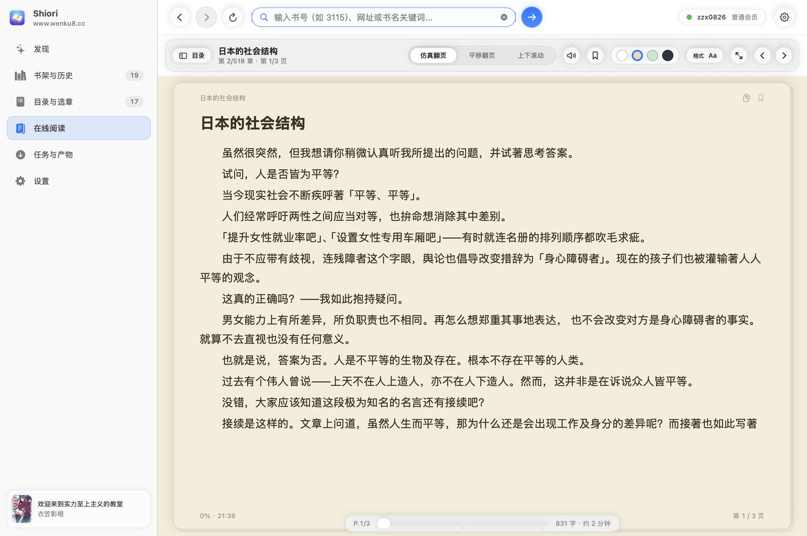
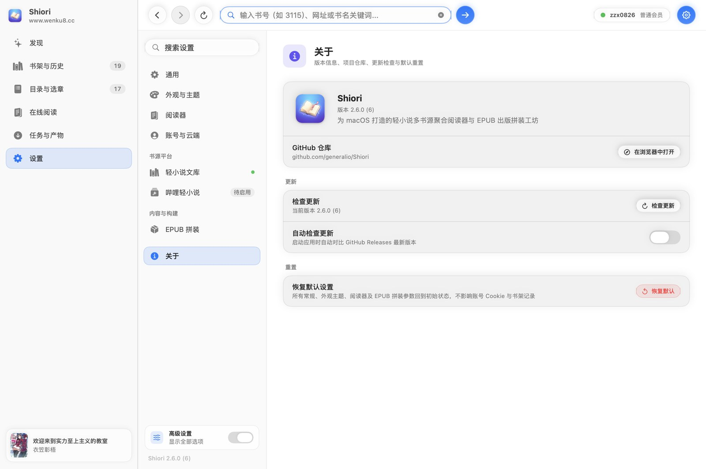

<div align="center">
  
  <h1>Shiori</h1>
  <p><strong>栞 · macOS 原生多书源轻小说与漫画阅读 / EPUB・CBZ 出版工坊（含 Python CLI）</strong></p>

  <p>
    <a href="https://github.com/generalio/Shiori/actions/workflows/ci.yml">
      
    </a>
    <a href="https://github.com/generalio/Shiori/releases">
      
    </a>
    <a href="LICENSE">
      
    </a>
    
    
    
  </p>

  <p>
    <a href="#核心特性">核心特性</a> •
    <a href="#界面预览">界面预览</a> •
    <a href="#快速开始">快速开始</a> •
    <a href="#cli-命令行指南">CLI 指南</a> •
    <a href="#epub-拼装与自定义">EPUB 拼装</a> •
    <a href="#致谢与原项目">致谢</a> •
    <a href="#开源许可">开源许可</a>
  </p>
</div>

---

## 简介

**Shiori**（取自日语「栞 Shiori」，意为夹在书页间的阅读书签）是一套面向轻小说与漫画双媒介阅读、多书源热插拔聚合检索，以及 **EPUB 3.0 / 2.0 & CBZ 出版级封装工具**，由两部分构成：

1. **macOS 原生桌面客户端（`Shiori.app`）**：基于 SwiftUI + macOS 26+ 原生 **Liquid Glass（液态玻璃）** 打造，采用模块化 `BookSourceKit` + `SourceAggregationEngine` 热插拔架构，内置三大默认启用书源：**轻小说文库（Wenku8）**、**哔哩轻小说（Bilinovel，支持外部浏览器 `Copy as cURL` 导入与可选本地 Python `curl_cffi` TLS 桥接）** 与 **拷贝漫画（Copymanga，App API v3 直连）**。提供跨媒介发现与聚合检索、本地馆藏统一管理与按源独立云书架同步、轻小说仿真翻页 / 漫画条漫竖滑与单页 RTL 阅读器、右侧书评楼中楼，以及 EPUB / CBZ 双格式导出。
2. **跨平台命令行工具（`lightnovel.py`）**：轻量、无图形依赖，具备与桌面端对等的书籍检索、书评查看、终端阅读、单卷/多卷合集 EPUB 拼装能力，适合批处理与终端用户。

---

## 核心特性

### 1. 多书源热插拔、双媒介发现与会话认证
- **三大书源默认开箱即用**：内置 `Wenku8`、`Bilinovel` 与 `Copymanga` 书源，可在设置页热插拔启停；支持按**媒介（全部 / 轻小说 / 漫画）**与**书源**双重过滤，支持 URL、`bili:`/`copy:`/`wenku8:` 前缀精准路由以及裸数字编号的跨源快捷切换提示。
- **多书源独立会话中心与外部浏览器导入**：顶栏聚合展示各书源认证状态，凭证保存在 POSIX `0600` 权限的本地配置中；针对 Cloudflare 严格校验场景，支持**系统浏览器手动登录/验证 + 一键粘贴 `Copy as cURL` 自动提取 Cookie / User-Agent / Token**，并提供可选的本地 Python `curl_cffi` TLS 指纹兼容桥接。
- **本地馆藏大一统 + 源级隔离云同步**：统一聚合所有书源的本地馆藏（`LocalShelf`）与浏览历史，支持按媒介与书源筛选；Wenku8 双向云书架与 Copymanga Token 个人云收藏按各自书源边界独立同步合并，单源凭证失效时优雅降级不污染本地数据。

### 2. 轻小说仿真阅读器 & 漫画条漫 / 单页阅读器
- **轻小说阅读器**：内置章节目录侧栏、四套阅读主题（素白 / 羊皮纸 / 护眼绿 / 夜间）、仿真翻页/平移/滚动、字体与排版微调、本地语音朗读、**插图大图灯箱预览**，以及 Bilinovel 未解码 PUA 混淆字库漂移告警。
- **漫画阅读器（`.manga`）**：支持**条漫竖向无缝滚动（默认）**与**单页翻页（日漫 RTL / LTR 方向切换）**，阅读漫画时自动隐藏不适用文字控件；底层采用 `BoundedReaderImageCache` 有界内存 LRU 与当前页前后 `±5` 页滑窗按需预取，百页长漫依然流畅不爆内存。
- **可视化分卷/分组目录与书评楼中楼**：小说支持分卷选章与右侧 `.inspector` 书评楼中楼；漫画支持连载/单行本分组（`WorkGroup`）、正序/倒序一键切换。

### 3. 出版级 EPUB 与漫画 CBZ 封装工坊
- **轻小说 EPUB 3.0 / 2.0**：支持单卷独立与多卷合集二级目录、简介扉页、彩插放置与去重、录入组清洗、自定义封面/CSS 与命名模板。
- **漫画双格式导出**：支持 **`CBZ`（零重编码保留原始 WebP/JPG，体积小速度快）** 与 **固定版式图版 `EPUB`（自动将 `.webp` 转码为高画质 `.jpg`，兼容 Apple Books / Kindle）**，支持多话合并单本或每话独立输出及 `c1500x` 高清开关。

---

## 界面预览

<div align="center">
  <p><strong>发现与多渠道聚合检索</strong></p>
  
  <br/><br/>
  <p><strong>云端书架同步与浏览历史</strong></p>
  
  <br/><br/>
  <p><strong>目录选章与右侧书评抽屉</strong></p>
  
  <br/><br/>
  <p><strong>仿真翻页阅读器 · 多主题与插图灯箱</strong></p>
  
  <br/><br/>
  <p><strong>设置与多书源插件管理</strong></p>
  
</div>

---

## 快速开始

### 方式一：下载 macOS Release 安装包

前往 [Releases 页面](https://github.com/generalio/Shiori/releases) 下载最新 `Shiori-v*-macOS-arm64.dmg` 或 `.zip`，拖入「应用程序」即可运行（macOS 26+ Apple Silicon）。

> 若首次打开提示来自未签名开发者，可在系统「隐私与安全性」中允许打开，或执行：
> ```bash
> xattr -cr /Applications/Shiori.app
> ```

### 方式二：从源码使用 Xcode 构建 macOS 客户端

需要 macOS 26+、Xcode 26+（已验证 Xcode 27.2）与 `xcodegen`：

```bash
brew install xcodegen
./Wenku8Studio/build_app.sh
open Shiori.app
```

运行 Swift 单元测试：

```bash
cd Wenku8Studio
xcodegen generate
xcodebuild test -project Wenku8Studio.xcodeproj -scheme Wenku8Studio -destination 'platform=macOS'
```

---

## CLI 命令行指南

安装 CLI 依赖（纯命令行，无需安装任何桌面 GUI 库）：

```bash
pip install -r requirements.txt -i https://pypi.org/simple/
```

### 常用命令示例

```bash
# 1. 交互模式（支持 info / search / author / toplist / reviews / thread / read 快捷指令）
python lightnovel.py

# 2. 查看书籍详情、简介、标签与分卷目录
python lightnovel.py --book_no 3115 --info

# 3. 下载单卷 / 多卷（输出为 EPUB 3.0，支持 2、1-3、1,2,3、all）
python lightnovel.py --no_input --book_no 3115 --volume_no 1-3 --out_dir ./out

# 4. 将第 1~3 卷合并为单本带二级分卷目录的合集 EPUB，并清理录入组头部声明
python lightnovel.py --no_input --book_no 3115 --volume_no 1-3 --merge --clean_credits

# 5. 按作者检索（免登录）或按书名/榜单检索（需通过 --cookie 或 WENKU8_COOKIE 传 Cookie）
python lightnovel.py --search "猫玄" --search_type author
python lightnovel.py --toplist allvisit --cookie "jieqiUserInfo=...; PHPSESSID=..."

# 6. 查看书评列表与具体帖子的楼层/楼中楼回复
python lightnovel.py --book_no 3115 --reviews
python lightnovel.py --review_id 319681

# 7. 在终端直接阅读指定卷章正文（如第 1 卷第 2 章）
python lightnovel.py --book_no 3115 --read 1:2
```

完整参数列表可通过 `python lightnovel.py --help` 查看。

---

## EPUB 拼装与自定义

| 配置项 | macOS 客户端（设置） | CLI 参数 |
| :--- | :--- | :--- |
| **规范版本** | EPUB 3.0（兼容 2.0）/ EPUB 2.0 | `--epub_version {2,3}` |
| **导出策略** | 每卷独立 / 多卷合并合集 | `--merge` |
| **封面与扉页** | 包含封面、自定义本地封面、简介扉页 | `--no_cover` / `--cover_file` / `--no_info` |
| **彩插排版** | 独立分页 / 单页拼接 / 忽略；前/后放置；追加本地彩页 | `--single_color_page` / `--no_color` / `--color_after` / `--extra_color` |
| **正文样式** | 段首缩进、行高、段间距、清理录入组声明 | `--indent` / `--line_height` / `--para_spacing` / `--clean_credits` |
| **命名与覆写** | `{title}` `{volume}` `{index}` `{author}` `{id}` | `--title` / `--author` / `--filename_template` |

---

## 自动构建与发版

仓库已配置自动化 GitHub Actions 工作流：

- **持续集成**（[ci.yml](.github/workflows/ci.yml)）：推送或 PR 至主分支时自动运行 Python CLI/EPUB 测试与 macOS Xcode 编译测试。
- **Tag 自动发版**（[release.yml](.github/workflows/release.yml)）：推送 `v*` 标签时自动运行测试、编译 `Shiori.app` 并打包发布 macOS `.dmg` 与 `.zip` 至 GitHub Releases：

```bash
git tag v2.4.0
git push origin v2.4.0
```

---

## 目录结构

```text
Shiori/
├── .github/workflows/          # GitHub Actions CI & macOS Tag 自动发版工作流
├── Wenku8Studio/               # Shiori — macOS 原生 SwiftUI 客户端（Liquid Glass）
│   ├── Sources/Wenku8Core/     # BookSourceKit SPI、书源聚合引擎、网络抓取与 EPUB 组装内核
│   ├── Sources/Wenku8Studio/   # SwiftUI 视图、缩略图缓存与状态管理
│   ├── Tests/Wenku8CoreTests/  # Swift XCTest 单元测试
│   ├── AppResources/           # 应用图标（Assets.xcassets / icon_raw.png）与 Info.plist
│   ├── project.yml             # XcodeGen 工程描述
│   └── build_app.sh            # 一键生成 .xcodeproj 并编译打包 .app
├── docs/PLUGIN_ARCHITECTURE.md # 多书源插件化与聚合架构设计文档
├── docs/screenshots/           # README 界面展示截图
├── Editer.py                   # Python 核心抓取、检索、书评与 EPUB 打包引擎
├── utils.py                    # Python EPUB 2/3 模板与 XML 转义工具
├── lightnovel.py               # Python CLI 入口
├── tests/test_core.py          # Python pytest 单元测试
├── AGENTS.md                   # 项目构建与 UI 组件开发规范
└── LICENSE                     # MIT 开源许可证
```

---

## 致谢与原项目

本项目的 Python 核心解析与初期 EPUB 构建思路源自开源项目 **[ShqWW/lightnovel-download](https://github.com/ShqWW/lightnovel-download)**（原作者 `ShqWW` / 王老板）。在此基础上，本仓库进行了独立架构演进与大幅功能重构——新增了原生 macOS SwiftUI 客户端（**Shiori**）、`Wenku8Core` 多书源插件化与云端书架双向同步引擎、EPUB 3.0 组装与仿真阅读器，以及扩展的 CLI 与自动化 CI/CD 发版管线，特此向原项目致谢。

---

## 开源许可

本项目采用 **[MIT License](LICENSE)** 开源发布。

---

## 免责声明

本项目仅供个人学习与离线阅读排版技术交流使用，请支持正版轻小说，勿用于商业用途或高频恶意爬取。
